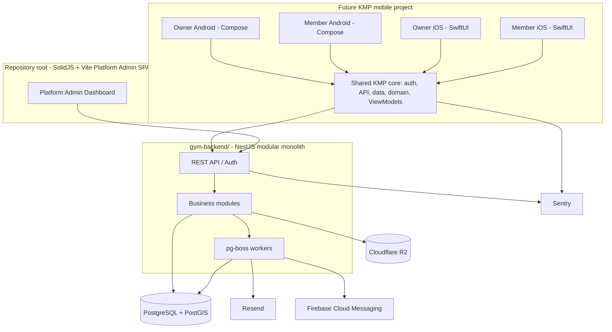

# System Architecture

## Context

The platform consists of:
- Four native mobile applications within one KMP project.
- One SolidJS + Vite Platform Admin web application.
- One NestJS modular-monolith backend.
- One PostgreSQL/PostGIS database initially colocated with the backend on a VPS.
- Cloudflare services for DNS/CDN/edge protection and R2 object storage.
- Resend for transactional email.
- FCM for push delivery.
- Sentry for error and performance monitoring.

## System diagram

## Architecture decisions

- Backend is a modular monolith, not microservices.
- One NestJS application with domain modules.
- PostgreSQL shared `public` schema; tenant-owned rows have `organization_id`.
- PostGIS is mandatory.
- TypeORM handles persistence and migrations.
- `synchronize: true` only in Development; `false` in Staging and Production.
- pg-boss uses PostgreSQL for background jobs; no Redis in V1.
- REST + FCM; no WebSockets in V1.
- No dedicated cache in V1.
- R2 stores media; NestJS authorizes and issues short-lived presigned URLs.
- Same VPS for Staging and Production initially, with separate Compose projects, DBs, credentials, networks, domains and volumes. This is a cost-driven compromise, not strong host-level isolation.
- Backend can later be moved to separate VPS or services without changing domain architecture.

## Backend module candidates

- Auth
- Users
- Organizations
- Branches
- Memberships
- Subscriptions
- Payments
- Attendance
- Workouts
- ExerciseCatalogue
- Notifications
- Media
- Analytics
- Audit
- Jobs
- AppVersionPolicy

Modules own their domain logic and repositories. Cross-module interaction uses exported application services for synchronous transactional work and domain events/outbox for asynchronous reactions.

## Platform Admin architecture

- Separate internal web application using SolidJS + Vite.
- Client-side SPA; NestJS remains the only backend.
- Uses approved OpenAPI business contracts and Better Auth's supported browser integration.
- Platform-level administrator permissions are separate from organization Owner/Member roles.
- No direct database access from the browser.
- REST/query invalidation and conservative periodic refresh in V1; no WebSockets/SSE.
- See `06-admin/` for scope and frontend architecture.

## Mobile architecture

One KMP project:
- Shared Kotlin business/domain/data/network layers.
- Android UI uses Jetpack Compose.
- iOS UI uses SwiftUI.
- Shared ViewModels use StateFlow.
- Ktor for networking.
- Koin for dependency injection.
- Native navigation: Navigation Compose on Android, NavigationStack on iOS.
- No Compose Multiplatform UI requirement.
- No local SQL/offline sync in V1.
